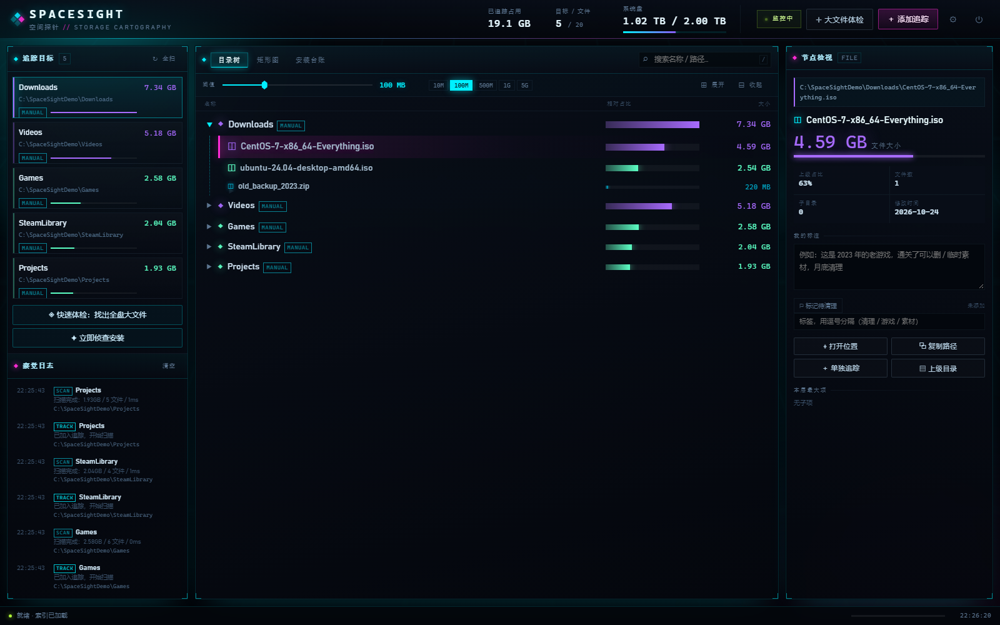
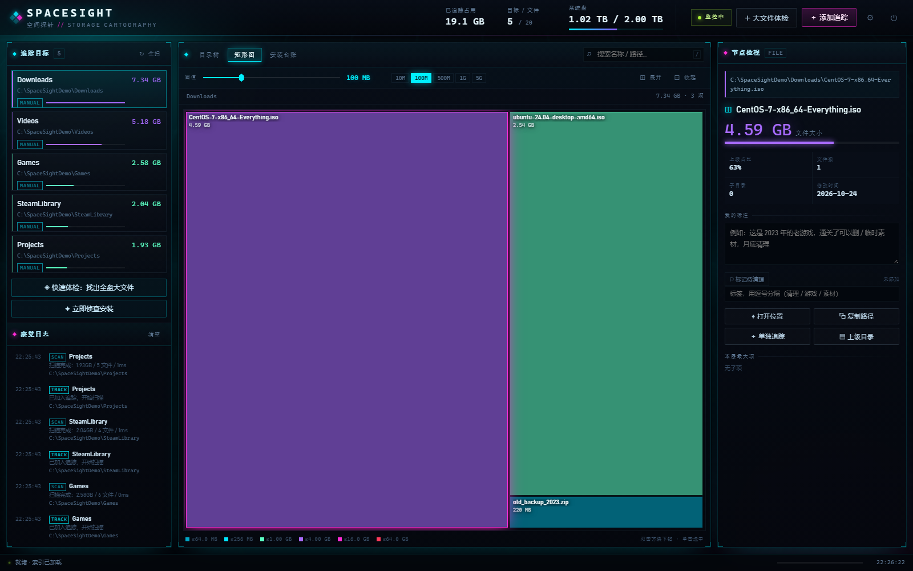
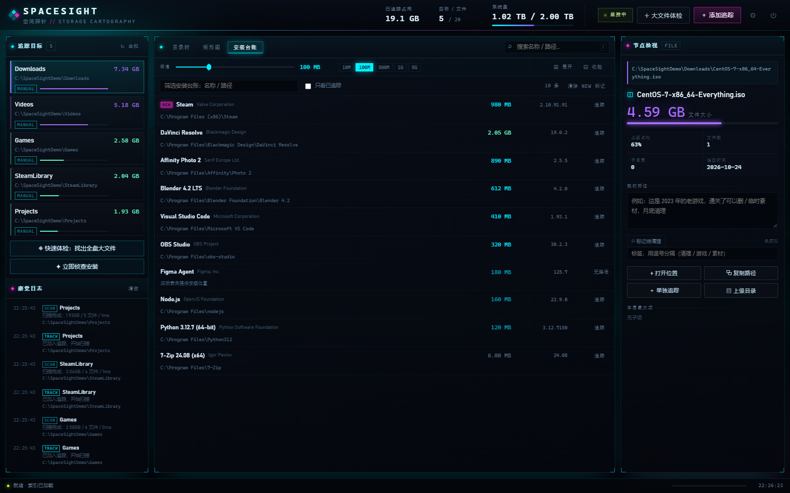

# SpaceSight // 空间探针 · 用户使用说明

> 版本 1.0.2 · 适用于 Windows 10 / 11
> 本文按"第一次打开 → 日常使用 → 遇到问题"的顺序组织，不需要任何技术背景。
> 文中的界面截图使用演示数据，路径为示例，你本机看到的会是自己的目录。

---

## 目录

1. [这个工具解决什么问题](#1-这个工具解决什么问题)
2. [运行环境与启动](#2-运行环境与启动)
3. [界面导览](#3-界面导览)
4. [第一次使用：建立你的空间地图](#4-第一次使用建立你的空间地图)
5. [自动察觉：它是怎么知道我刚装了什么](#5-自动察觉它是怎么知道我刚装了什么)
6. [目录树：看懂每个目录有多重](#6-目录树看懂每个目录有多重)
7. [阈值：只关心大块头](#7-阈值只关心大块头)
8. [矩形图：一眼看出谁最占地方](#8-矩形图一眼看出谁最占地方)
9. [安装台账：我到底装了什么](#9-安装台账我到底装了什么)
10. [标注、标签与待清理标记](#10-标注标签与待清理标记)
11. [大文件体检](#11-大文件体检)
12. [设置、数据与备份](#12-设置数据与备份)
13. [典型场景](#13-典型场景)
14. [快捷键](#14-快捷键)
15. [常见问题 FAQ](#15-常见问题-faq)
16. [术语表](#16-术语表)

---

## 1. 这个工具解决什么问题

装游戏、下镜像、解压素材……用久了磁盘越来越满，但你不知道"到底是哪个东西吃掉了 200GB"。
传统的做法是打开资源管理器一层层翻，或者用扫描软件等上十几分钟。

SpaceSight 换了个思路：**在你安装/解压的那一刻就把位置和大小记下来**。

- 装游戏时 → 它能察觉到"哪里多了一个新目录"，自动开始测量
- 解压完成后 → 它知道哪个文件夹刚刚变大
- 你手动下载的大文件 → 用「大文件体检」几秒钟找出来

记录下来的东西，用一张**目录树**和一张**矩形图**展示，大到 100GB 的游戏、小到 200MB 的补丁包，
都用面积和颜色直观区分，还能给每个目录写备注："这游戏通关了，可以删"。

**它只读不写**：只读取文件大小和目录结构，绝不删除、移动、修改你的任何文件。

---

## 2. 运行环境与启动

### 2.1 需要什么

- Windows 10 或 Windows 11
- **Python 3.9 或更高版本**（后端运行环境，不需要安装任何额外的库）

如果还没装 Python：打开 <https://www.python.org/downloads/windows/> 下载安装包，
**安装时务必勾选 “Add python.exe to PATH”**，装完重启一次电脑再双击启动器。

> 启动器会自动在以下位置寻找 Python：程序目录下的 `runtime\python.exe` →
> 系统 `PATH` → `%LOCALAPPDATA%\Programs\Python\Python3*` → 开发机内置运行时。
> 找不到时它会弹窗告诉你怎么办。

### 2.2 启动

| 文件 | 说明 | 适合谁 |
|---|---|---|
| **`SpaceSight.exe`** | 双击后**没有任何黑窗口**，1 秒内自动弹出浏览器界面；日志写入 `data\server.log` | 日常使用（推荐） |
| **`start-spacesight.bat`** | 双击后保留一个控制台窗口，能看到启动日志和实际端口 | 出问题时排查 |

启动成功后，任务栏会出现浏览器窗口（默认地址 `http://127.0.0.1:8765/`）。

> **端口被占用怎么办？** 程序会自动顺延到 8766、8767……（最多 12 个），
> 并自动打开正确地址。用 bat 启动时能在窗口里看到实际端口；
> 也可以打开 `data\server.port` 文件查看。

### 2.3 停止

- 点击界面右上角的 **⏻** 按钮 → 确认
- 或者用 bat 启动时，直接关闭那个黑色控制台窗口
- 或者打开任务管理器，结束 `python.exe` 进程

> **只关闭浏览器标签页不会停止服务**，后台仍在侦测新安装。想彻底关闭请用上面的办法。

---

## 3. 界面导览



整个界面分四块：

| 区域 | 位置 | 有什么 |
|---|---|---|
| **顶栏** | 最上方 | 已追踪占用总量、目标/文件数、系统盘已用/总量；右侧是「监控中」状态灯、`＋ 添加追踪`、`✛ 大文件体检`、`⚙ 设置`、`⏻ 停机` |
| **追踪目标 + 察觉日志** | 左侧 | 上半部分是已追踪目录清单（点一下切换/展开）；下半部分是自动侦测事件流 |
| **主视图** | 中间 | 三个标签页：**目录树** / **矩形图** / **安装台账**；上方是阈值滑杆与搜索框 |
| **节点检视** | 右侧 | 选中节点的完整路径、大小、占比、文件数、修改时间，以及**备注 / 标签 / 待清理标记**和操作按钮 |

底部状态栏会实时显示当前正在扫描什么（多少目录、多少文件），以及时钟。

---

## 4. 第一次使用：建立你的空间地图

第一次打开是空状态，有两个入口：


### 方式 A：添加一个目录（最常用）

1. 点右上角 **`＋ 添加追踪`**
2. 在弹窗里输入路径，或点 **`⌖ 浏览目录`** 用内置浏览器逐级点进去
   （第一列选盘符，第二列点目录进入，也可以直接粘贴 `D:\Games\新游戏`）
3. 点 **`添加并扫描`**

扫描是后台进行的，底部状态栏会滚动显示进度。像 4000 个文件、5GB 的目录通常**不到 0.2 秒**就能扫完；
几十万文件的巨型目录需要几分钟，期间你可以继续用界面。

### 方式 B：先做一次大文件体检（不知道从哪下手时）

1. 点 **`✛ 大文件体检`**
2. 范围填 `C:\` 或某个盘符，勾选"只关心大于 100M/500M/1G/5G"
3. 点 `开始体检`，等结果
4. 结果分「最大文件 / 最大目录」两页，每条后面有 `追踪` 按钮，点一下就把该项加入长期追踪

> **建议**：不要一上来就追踪整个 `C:\`。磁盘根目录包含大量系统文件，扫描慢且意义不大。
> 推荐先追踪这些位置：`C:\Program Files`、`C:\Program Files (x86)`、`D:\Games`、
> `D:\Downloads`、`%LOCALAPPDATA%\Programs`、以及你放素材/镜像的目录。

### 方式 C：等它自己发现

启动后 SpaceSight 已经在后台侦测了。之后每次安装软件、解压压缩包，
新的目录会自动出现在左侧「追踪目标」里，并带上紫色 `NEW` 标记。

---

## 5. 自动察觉：它是怎么知道我刚装了什么

SpaceSight 同时盯着三路信号，任意一路发现变化就会记账：

### ① 注册表安装台账（每 5 秒）

Windows 上每个正规安装的程序都会在注册表里留一条记录（"程序和功能"里能看到的就是它）。
SpaceSight 定时对比这份名单：

- 首次运行 → 静默导入全部已安装程序，建立**基线**（不会刷屏）
- 之后出现新条目 → 判定为「刚刚装了什么」，记录名称、版本、发行商、安装位置、估算大小
- 如果注册表提供了安装路径 → **自动加入追踪并测量真实占用**

在「安装台账」标签页可以看到完整名单（本机实测可读到 40+ 条，含百度网盘、微信、Chrome 等）。

### ② 安装/解压进程监控（每 3 秒）

通过 Windows 进程快照识别特征名（`setup`、`install`、`msiexec`、`7zg`、`winrar`、`bandizip`、
`update`、`dxsetup`、`vc_redist` …）。一旦发现有安装器在跑：

1. 立刻给常用安装位置拍一张"照片"（`C:\Program Files`、`C:\Program Files (x86)`、
   `%LOCALAPPDATA%`、`%APPDATA%`、各固定磁盘根目录…）
2. 安装器退出后再拍一张，对比找出**新出现的目录**
3. 新目录自动加入追踪并开始测量

这一步能覆盖**绿色版/免安装程序**——它们不写注册表，但一定会解压出文件夹。

### ③ 目录变更侦测（每 20 秒）

对常用安装位置、各固定磁盘根目录，以及**你自己添加的每一个追踪目录**做"一级子项"比对：

- 安装位置出现新目录 → 自动纳入追踪
- 追踪目录里出现新内容 → 自动重扫该目录（更新大小）
- 安装位置出现 ≥500MB 的新文件 → 写一条事件提醒

### 自动追踪的取舍（为什么有些新目录不会进来）

为了不让追踪列表被碎片塞满，自动纳入追踪有三道门槛：

| 规则 | 说明 |
|---|---|
| **只追踪"装软件的地方"** | `Program Files`、`Program Files (x86)`、`%LOCALAPPDATA%\Programs`、各磁盘根目录出现的新目录会自动追踪；而 `%LOCALAPPDATA%`、`%APPDATA%`、`%ProgramData` 变化太频繁，**只写进察觉日志、不自动追踪** |
| **小于 300MB 自动撤回** | 自动追踪后扫描发现不足 300MB，会被自动移出并记一条 `UNTRACK` 事件（浏览器缓存、扩展配置就属于这类）。需要的话可以手动添加 |
| **不重复追踪** | 如果某个目录已经在追踪范围内、或它包含了已有目标，就不会再单独追踪，避免同一个东西被算两遍 |

注册表察觉到的**已安装程序**不受这些门槛限制（那是你主动安装的软件，最值得记账）。

### 事件流长什么样

左侧「察觉日志」会按时间倒序列出所有事件，例如：

```
20:35:10  CHANGE   Games             追踪目录内出现新内容，已排队重扫
20:35:10  SCAN     演示样本           扫描完成：26.39GB / 24 文件 / 7ms
20:28:11  TRACK     Microsoft 系      已加入追踪，开始扫描
```

点击任何一条事件，会在资源管理器里打开对应位置。

### 觉得太吵？

- 点顶栏的 **「监控中」** 徽标：暂停/恢复整个后台察觉
- 或者打开 **`⚙ 设置`** → 关闭「自动纳入追踪」：仍然记录日志和台账，但不会自动往追踪列表里塞东西

### 为什么有时没察觉到？（重要）

自动察觉是**概率性**的，以下情况会漏：

| 情况 | 为什么 | 怎么办 |
|---|---|---|
| 单文件绿色程序（一个 exe 直接跑） | 不建目录、不写注册表 | 手动添加该文件 |
| 安装到已存在的目录（如 `D:\Games` 下再建子目录） | 已追踪目录内新增 → 会触发重扫并更新大小，但不会单独列为新目标 | 在树里找到它，选中后点 `＋ 单独追踪` |
| 安装器把文件写进更深层的老目录 | 只比对一级子项 | 手动 `↻` 重扫父目录 |
| 安装过程中你手动关闭了程序 | 后台线程随进程结束 | 重新打开后点「✦ 立即侦查安装」 |

**兜底方案永远有效**：`＋ 添加追踪` 手动指定位置，或「大文件体检」把大块头挖出来。

---

## 6. 目录树：看懂每个目录有多重


每一行是一个目录或文件，包含四类信息：

1. **节点名**（目录带 ▣ 图标，文件按类型显示 ◫ 镜像 / ◈ 程序 / ▶ 视频 / ▤ 文档 …）
2. **相对占比条** —— 该节点占"上一级目录"的百分比
3. **精确大小**（KB/MB/GB/TB，保留合适精度）
4. **标记**：`▤` 有备注、`⚑` 已标记待清理

### 视觉语法（用眼睛就能排序）

| 大小档位 | 颜色 | 含义 |
|---|---|---|
| < 64 MB | 灰蓝 | 零碎文件 |
| 64 MB – 256 MB | 青 | 小占用 |
| 256 MB – 1 GB | 亮青 | 中等 |
| 1 GB – 4 GB | 薄荷绿 | 大 |
| 4 GB – 16 GB | 紫 | 很大 |
| 16 GB – 64 GB | 品红 | 巨型 |
| ≥ 64 GB | 高热红 | 空间黑洞 |

同时在**同一层**内，越大的节点：行更高、字号更大、图标更大更亮、占比条更粗更亮（有上限，不会无限制放大）。

### 操作

| 动作 | 效果 |
|---|---|
| 单击一行 | 选中（右侧显示详情）+ 展开/收起子目录 |
| 点击左侧 `▶` | 只展开/收起，不改变选中 |
| 双击一行 | 重新选中该节点（避免误触） |
| 点 `＋ 显示更多（共 N 项）` | 子项超过 400 个时翻页加载 |
| `⊞ 展开` | 自动展开前两层，快速看清结构 |
| `⊟ 收起` | 全部折叠 |
| 顶部搜索框 | 边输边搜（名称匹配，跨全部目标），点结果自动逐级展开并高亮定位 |

树底部会提示 **"另有 N 项小于当前阈值，已隐藏"**，让你知道没有被展示的零碎项有多少。

---

## 7. 阈值：只关心大块头

顶部工具条中间的**阈值**控制"多小的东西不配出现在我眼前"。

- 拖动滑杆：范围 10 MB ～ 50 GB（对数刻度，小范围也能精细调）
- 快捷按钮：`10M` `100M` `500M` `1G` `5G`
- 默认 **100 MB**，这个值会保存在数据库里，下次打开仍生效

阈值同时作用于**文件**和**目录**：整个子树都小于阈值的目录会被直接隐藏；
但只要目录本身够大，它内部小于阈值的子项仍会被隐藏——这正是"大块头优先"的浏览方式。

> **注意**：快照里只保留 ≥64 KB 的文件（避免几百万个碎片撑爆数据库）。
> 如果你的阈值调到 64 KB 以下，更小的文件不会出现——这是有意的取舍。

---

## 8. 矩形图：一眼看出谁最占地方



矩形图（Treemap）用**面积严格正比于大小**的方式铺满整个视图：

- 方块越大 → 占用越多（这是唯一一个面积完全等比的可视化）
- 颜色沿用目录树的热度色阶，所以你能同时看到"大"和"类别"
- 一级方块内还会画出它的主要子项（第二层），一眼看清"这个游戏里是什么最占地方"

> **矩形图一次只画一个追踪目标**：展示的是左侧列表里**高亮**的那张卡片对应的目标。
> 点左侧其他目标即可切换；刚用 `＋ 添加追踪` 加进来的目标会自动切过去。
> 面包屑第一项永远是当前根目标的名字，右侧显示它的总大小与项目数。

### 操作

| 动作 | 效果 |
|---|---|
| 单击方块 | 选中并在右侧显示详情 |
| 双击一级方块 | **下钻**到该目录，方块变成它的子项 |
| 点击顶部面包屑 | 返回上层 |
| 鼠标悬停 | 提示完整路径、大小、占本层比例 |
| 拖动阈值 | 立刻重算，只画大于阈值的内容 |

---

## 9. 安装台账：我到底装了什么



「安装台账」标签页读取 Windows 注册表里所有已安装程序，列出：

- 名称、发行商、版本
- **估算大小**（注册表里记录的安装大小，仅供参考）
- 安装路径（部分软件不提供，会显示"注册表未提供安装位置"）
- 右侧动作：`追踪`（加入空间追踪并测量真实占用）/ `已追踪`

顶部可以筛选（名称或路径）、勾选「只看已追踪」。
新装软件会带紫色 `NEW` 标记，看完点 `清除 NEW 标记` 即可。

> 为什么大小和"程序和功能"里一致却不等于实际占用？因为注册表里是**安装时写入的估算值**，
> 而游戏本体、后续更新、存档、缓存都不在里面。想看真实占用，点 `追踪` 让它扫一遍。

---

## 10. 标注、标签与待清理标记

选中任意节点（目录或文件）后，右侧面板可以：

| 功能 | 说明 |
|---|---|
| **备注** | 多行文本，例如"2023 年通关，可删""公司项目归档，别动"。停止输入约 0.7 秒自动保存，失焦也会保存 |
| **标签** | 逗号分隔，例如 `清理,镜像,游戏`。用于你自己分类（不参与筛选，纯记录） |
| **⚐ 标记待清理** | 打上红色标记，树里该行会出现 `⚑`。这是你的"待删清单" |
| **⌖ 打开位置** | 在资源管理器中打开该目录（文件会选中） |
| **⧉ 复制路径** | 复制完整路径到剪贴板 |
| **＋ 单独追踪** | 把子目录/文件提升为独立的追踪目标（当它比父目录更值得单独盯着时） |
| **▤ 上级目录** | 打开父目录 |
| **↻ 重新扫描 / ✕ 移出追踪** | 仅对追踪目标根节点显示 |

### 备注会丢吗？

不会。备注按**路径**保存在数据库里，与追踪目标解耦：

- 把目录移出追踪 → 备注**保留**
- 以后重新添加同一路径 → 备注自动恢复
- 即使文件被删了，备注也还在（只是暂时没有对应节点）

底部「本层最大项」列出该目录下最大的 10 个子项，点一下即可跳转选中。

---

## 11. 大文件体检

不知道从哪下手时用它：

1. 点顶栏 `✛ 大文件体检`（或左下角 `◈ 快速体检：找出全盘大文件`）
2. 范围：输入 `C:\`、`D:\Games` 等，或点 `⌖ 浏览`
3. 阈值：100M / 500M / 1G / 5G
4. 开始体检 → 实时显示已遍历文件数与累计字节
5. 结果页：
   - `最大文件 N` / `最大目录 N` 标签切换
   - 每行点 `追踪` 单独加入
   - 点 `＋ 全部加入追踪` 批量加入当前页前 12 项

体检是**临时遍历**，不写入索引，也不会改变你的追踪列表（除非你点了追踪）。

---

## 12. 设置、数据与备份

点顶栏 **`⚙`**：

- **后台察觉**：总开关（等价于点「监控中」徽标）
- **自动纳入追踪**：关闭后只记录、不自动添加
- **本地数据**：显示数据库路径、索引节点数、追踪目标数、台账条数、标注条数
- **⭳ 导出 JSON 快照**：把追踪目标、标注、事件、安装台账导出成一个 JSON 文件（可用于备份或二次分析）
- **运行信息**：服务地址、版本、已运行时长

### 数据在哪

```
SpaceSight\data\spacesight.db      ← 全部数据（SQLite 单文件）
SpaceSight\data\server.log         ← 无控制台启动时的日志
SpaceSight\data\server.port        ← 当前使用的端口号
```

**备份**：关闭服务后，把整个 `data` 文件夹复制走即可。
**迁移到新电脑**：把整个 `SpaceSight` 文件夹复制过去（路径变了的话，删除对应追踪目标重新添加即可）。
**卸载**：关闭服务，删除整个 `SpaceSight` 文件夹。不写注册表，不驻留后台。

### 隐私

- 只监听 `127.0.0.1`，局域网内其他设备访问不到
- 不发送任何网络请求，不收集任何信息
- 扫描只做 `stat` 与列目录，**只读**，不会修改文件时间戳之外的任何东西

---

## 13. 典型场景

### 场景一：我想清理 C 盘，但不敢乱删

1. `✛ 大文件体检` 扫 `C:\`，阈值 1G
2. 看「最大目录」页：`C:\Windows`、`C:\Program Files` 这类系统目录**别动**
3. 找 `AppData`、`Downloads`、`Temp`、游戏缓存这类目录 → 点 `追踪`
4. 在目录树里逐层展开，找到具体的大文件
5. 给确认可删的项点 `⚐ 标记待清理`，并写备注"确认后再删"
6. 真正删除仍然在资源管理器里做（本工具不提供删除，避免误操作）

### 场景二：刚装了个 100GB 的游戏

1. 安装程序一启动，左侧日志出现 `INSTALLER msiexec.exe 安装/解压程序启动`
2. 装完后出现 `FOLDER 新目录` + `TRACK 已自动纳入追踪`
3. 追踪目标里多了一项，大小自动测好
4. 切换「矩形图」看这个游戏内部哪个资源包最大
5. 写备注："主线已通关，DLC 没玩"

### 场景三：我想长期盯住素材盘

1. `＋ 添加追踪` → 选 `D:\素材库`
2. 之后每次往里塞新素材，20 秒内自动重扫并更新大小
3. 新建的 `2025-项目` 子目录会触发 `CHANGE` 事件
4. 用阈值滑杆在"看全部"和"只看大块"之间切换

---

## 14. 快捷键

| 按键 | 功能 |
|---|---|
| `/` | 聚焦搜索框（输入时忽略） |
| `Ctrl + Alt + R` | 重新扫描全部追踪目标（`Ctrl + R` 留给浏览器刷新） |
| `Esc` | 关闭弹窗 / 收起搜索结果 |

---

## 15. 常见问题 FAQ

**Q1：双击 `SpaceSight.exe` 没反应？**
A：先看 `data\server.log` 有没有内容。更直接的办法是双击 `start-spacesight.bat`——它会显示具体错误。
最常见原因是没装 Python 或没勾选 "Add python.exe to PATH"。

**Q2：浏览器打开是空白/打不开？**
A：确认服务是否还在（看任务管理器有没有 `python.exe`）。
用 bat 启动时窗口里会打印 `界面地址 http://127.0.0.1:8765/`，地址可能因为端口占用而变化。

**Q3：新装的软件没自动出现？**
A：见 [为什么有时没察觉到](#为什么有时没察觉到重要)。
可以点左下角 `✦ 立即侦查安装` 手动触发一次；仍不行就手动添加。

**Q4：扫描一个目录特别慢？**
A：机械硬盘 + 几十万个小文件会很慢（几百万文件可能要十几分钟）。
建议：先用「大文件体检」定位，再对具体目录做追踪；或者先只看 1GB 以上的内容。

**Q5：为什么不显示某个文件？它明明有 50MB。**
A：三种可能：① 低于当前阈值（调低试试）；② 它小于 64KB 的快照下限；③ 该目录没有权限（系统保护目录）。
另外，云盘占位文件（如 OneDrive 未下载的文件）显示为 0 字节是正常的。

**Q6：大小算得准吗？**
A：逐文件累加 `st_size`，对普通文件是精确的。但有三点会让数字偏大/偏小：
① Windows 硬链接（`WinSxS` 等）会被重复计数；② 稀疏文件按逻辑大小计；③ 扫描期间文件被修改则以扫描时刻为准。
想知道实际占用，请与资源管理器"大小"列对比，四舍五入到 GB 后一般一致。

**Q7：会不会误删我的东西？**
A：不会。本工具**没有任何删除功能**，只读取目录结构和文件大小。

**Q8：能监控 D 盘吗？**
A：能。`＋ 添加追踪` 选 `D:\` 即可，但盘根目录通常很大，建议只添加具体目录。

**Q9：服务一直开着会很占资源吗？**
A：后台每 3～20 秒做一次轻量轮询（枚举进程、读注册表、列一级目录），内存约 40–80MB。
空闲时几乎不占 CPU。索引本身存在 SQLite 里，不常驻内存。

**Q10：换电脑 / 重装系统后数据还在吗？**
A：数据在 `data\spacesight.db`，随文件夹一起复制即可带走。但里面的路径是旧的，
新电脑上需要把失效的追踪目标删掉重新添加（备注会保留，因为按路径匹配）。

**Q11：多个窗口同时打开会冲突吗？**
A：不会。多开浏览器标签页只是多个前端；如果重复双击启动器，第二个实例会检测到服务已在运行，
直接打开已有界面然后退出。

**Q12：新装的软件在 Program Files 里建了目录，但没自动进追踪列表？**
A：三种可能：① 它小于 300MB，被自动撤回了（见「自动追踪的取舍」）；② 它建在已有追踪目标的内部，已被父目标覆盖；③ 它建在 `AppData` / `ProgramData` 这类只记录不追踪的位置。
都可以用 `＋ 添加追踪` 手动加进来，或在目录树里选中它点 `＋ 单独追踪`。

**Q13：顶部显示「监控暂停」是什么意思？**
A：你手动暂停了后台察觉（点一下「监控中」徽标会切换）。暂停后不再自动发现新安装、不再自动重扫，但所有已扫的数据、备注、手动添加都照常可用。再点一下就恢复。

**Q14：能看网络盘 / 移动硬盘吗？**
A：能（只要路径可访问）。但移动硬盘拔掉后，追踪目标会显示"缺失"状态，重新插上点 `↻` 即可恢复。

---

## 16. 术语表

| 术语 | 含义 |
|---|---|
| **追踪目标** | 你让 SpaceSight 长期记录大小的目录或文件（左侧清单里的每一项） |
| **快照 / 索引** | 一次扫描后保存下来的完整树结构（路径 + 大小），浏览时直接读它，不需要重新扫盘 |
| **阈值** | 过滤门槛，小于它的节点不显示 |
| **察觉日志** | 后台自动侦测到的事件流水（安装、新目录、重扫、扫描完成…） |
| **安装台账** | 从注册表读取的"已安装程序清单" |
| **体检** | 一次性遍历目录、列出最大文件的临时操作（不写入索引） |
| **NEW 标记** | 自动察觉到、刚加入的新目标，点过或重扫后自动消失 |

---

*如遇本文未覆盖的问题，请把 `data\server.log` 与复现步骤一并保留——日志里通常能直接看出原因。*
